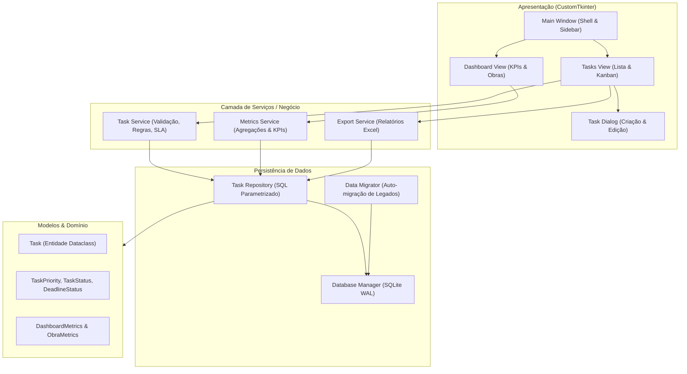

# 🏗️ Obras Pro • Gestão de Obras & Cronograma Enterprise

[](https://www.python.org/)
[](https://github.com/TomSchimansky/CustomTkinter)
[-003B57.svg?logo=sqlite&logoColor=white)](https://www.sqlite.org/)
[](LICENSE)
[](#-arquitetura)

Sistema corporativo de alto desempenho para acompanhamento de obras da construção civil, gestão de cronogramas, monitoramento de SLAs e análise executiva de canteiros de obras.

---

## 📸 Visão Geral da Interface

- **Cockpit Executivo**: Dashboard com 5 KPI Cards (Total, Em Andamento, Concluídas, Atrasadas e Canteiros Ativos), barras de progresso físico individuais por obra e lista de foco imediato para atrasos e urgências.
- **Visualização Dupla (Lista & Quadro Kanban)**:
  - **Modo Lista**: Tabela detalhada de cards com avatares de responsáveis, chips de SLA e ações rápidas.
  - **Modo Kanban**: 4 colunas operacionais (`Pendentes`, `Em Andamento`, `Bloqueadas`, `Concluídas`) com botões de avanço de etapa em 1 clique (`◀` e `▶`).
- **Design System Obsidian / Sapphire**: Interface moderna em Modo Escuro ou Modo Claro com contraste refinado.
- **Exportação Executiva em Excel (.xlsx)**: Relatório completo com formatação corporativa, alertas condicionais e resumo de indicadores.

---

## 🏛️ Arquitetura do Software

Construído sob os princípios de **Clean Architecture** e separação de responsabilidades (SRP):



---

## 📁 Estrutura de Diretórios

```
├── app.py                     # Ponto de entrada (Bootstrap) e loop de eventos
├── config.py                  # Configurações globais, paths e logging
├── requirements.txt           # Dependências do projeto
├── LICENSE                    # Licença MIT
├── .gitignore                 # Arquivos ignorados pelo Git
│
├── models/                    # Modelos de domínio e enums tipados
│   ├── enums.py               # TaskPriority, TaskStatus, DeadlineStatus
│   ├── task.py                # Entidade Task com regras e cálculo de prazos
│   └── metrics.py             # DTOs de métricas consolidadas
│
├── database/                  # Infraestrutura SQLite
│   ├── connection.py          # Conexão transacional com WAL Mode
│   └── migrator.py            # Schema DDL, índices e auto-migração de legados
│
├── repositories/              # Camada de Acesso a Dados
│   └── task_repository.py     # Queries parametrizadas e filtros combinados
│
├── services/                  # Regras de Negócio e Serviços
│   ├── task_service.py        # Validações estritas de datas e cronogramas
│   ├── metrics_service.py     # Indicadores executivos para dashboard
│   └── export_service.py      # Exportação para planilhas Excel (.xlsx)
│
├── ui/                        # Interface Gráfica (CustomTkinter)
│   ├── theme.py               # Design System, tokens de cores e fontes
│   ├── components/            # KPICard, TaskCard, KanbanCard, FilterBar
│   ├── dialogs/               # Modal TaskDialog (criação/edição com atalhos de prazo)
│   ├── views/                 # DashboardView e TasksView (Lista + Kanban)
│   └── main_window.py         # Shell responsivo e barra de navegação lateral
│
└── tests/                     # Testes Unitários Automatizados
    ├── test_repository.py     # Testes de persistência e integridade SQLite
    └── test_task_service.py   # Testes de regras de negócio, SLA e exportação
```

---

## ⚡ Atalhos de Teclado Globais

| Atalho | Ação |
| :---: | :--- |
| `Ctrl + N` | Abrir modal de cadastro de **Nova Tarefa** |
| `Ctrl + E` | **Exportar Relatório Excel (.xlsx)** |
| `F5` | **Recarregar** todos os indicadores e tarefas |

---

## 🚀 Instalação e Execução

### 1. Clonar o Repositório
```bash
git clone https://github.com/SEU_USUARIO/SEU_REPOSITORIO.git
cd "SISTEMA 01"
```

### 2. Criar e Ativar Ambiente Virtual (Recomendado)
```bash
python -m venv venv
# No Windows:
.\venv\Scripts\activate
# No Linux/macOS:
source venv/bin/activate
```

### 3. Instalar Dependências
```bash
pip install -r requirements.txt
```

### 4. Executar o Aplicativo
```bash
python app.py
```

### 5. Executar os Testes Automatizados
```bash
python -m unittest discover tests
```

---

## 📄 Licença

Distribuído sob a licença **MIT**. Veja o arquivo [LICENSE](LICENSE) para mais detalhes.
